# Fatal Force: Comprehensive Analysis of US Police Shootings (2015 – 2017)

An in-depth data science and investigative analytics project analyzing fatal police shootings in the United States between January 2015 and July 2017. This project integrates [The Washington Post's Fatal Force Database](https://www.washingtonpost.com/graphics/investigations/police-shootings-database/) with multiple US Census Bureau demographic and socioeconomic datasets to uncover systemic patterns across poverty, education, race, age, weapons, and geography.

---

## Table of Contents
1. [Project Overview](#project-overview)
2. [Datasets & Data Cleaning](#datasets--data-cleaning)
3. [Visualizations, Analysis & Insights](#visualizations-analysis--insights)
   - [Section 1: Poverty & High School Graduation Dynamics](#section-1-poverty--high-school-graduation-dynamics)
   - [Section 2: Racial Makeup of States & Demographics of Shootings](#section-2-racial-makeup-of-states--demographics-of-shootings)
   - [Section 3: Gender Disparities & Age Distribution](#section-3-gender-disparities--age-distribution)
   - [Section 4: Weapons Carried & Mental Health Crises](#section-4-weapons-carried--mental-health-crises)
   - [Section 5: Geographic Patterns & Urban Racial Disparities](#section-5-geographic-patterns--urban-racial-disparities)
   - [Section 6: Temporal Trends Over Time](#section-6-temporal-trends-over-time)
4. [Summary of Key Findings](#summary-of-key-findings)
5. [Repository Structure](#repository-structure)
6. [How to Run Locally](#how-to-run-locally)
7. [Tech Stack & Libraries](#tech-stack--libraries)

---

## Project Overview

In 2015, *The Washington Post* began documenting every fatal shooting by an on-duty police officer in the United States, addressing a critical void in federal record-keeping. Across the 31 months in this dataset (January 1, 2015 – July 31, 2017), **2,535 people** were fatally shot by law enforcement.

This repository features the complete exploratory data analysis, interactive visualizations, and statistical modeling in [`Fatal_Force_(start).ipynb`](Fatal_Force_(start).ipynb), accompanied by a journalistic investigative report in [`ANALYSIS_REPORT.md`](ANALYSIS_REPORT.md).

---

## Datasets & Data Cleaning

The project synthesizes five datasets:

| Dataset | Records | Features | Content |
|---|---|---|---|
| `Deaths_by_Police_US.csv` | 2,535 | 14 | Individual incident records (name, age, gender, race, date, manner of death, weapon, mental illness, threat level, flee, body camera). |
| `Pct_People_Below_Poverty_Level.csv` | 29,329 | 3 | US Census community poverty rates by city and state. |
| `Pct_Over_25_Completed_High_School.csv` | 29,329 | 3 | US Census high school graduation rates (adults 25+) by city and state. |
| `Share_of_Race_By_City.csv` | 29,268 | 7 | US Census racial and ethnic population shares by city and state. |
| `Median_Household_Income_2015.csv` | 29,322 | 3 | US Census median household income figures by city and state. |

### Data Cleaning Workflow
- **Numeric Normalization:** Replaced missing/corrupted census symbols (`'-'`, `'(X)'`, `'+'`, `','`) and converted string fields to floating-point numerics.
- **Datetime Parsing:** Converted fatal incident dates (`DD/MM/YY`) to datetime timestamps for monthly and seasonal time-series analysis.
- **Missing Value Handling:** Managed unrecorded age (77 records) and race (195 records) through subset exclusions and demographic imputation where appropriate.

---

## Visualizations, Analysis & Insights

---

### Section 1: Poverty & High School Graduation Dynamics

#### Chart 1: Average Poverty Rate by US State
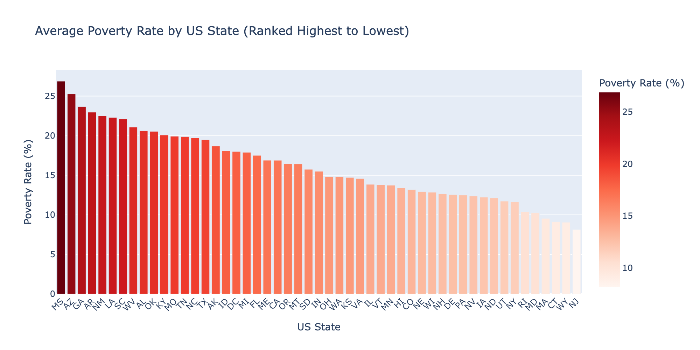
* **What it explains:** Ranks all 50 US states plus DC from highest to lowest by average community poverty rate based on census data.
* **Key Insights:** Mississippi exhibits the nation's highest average poverty rate at **26.88%**, followed by Arizona (25.27%) and Georgia (23.66%). In contrast, New Jersey records the lowest poverty rate at **8.16%**, illustrating stark regional socioeconomic divides across the country.

---

#### Chart 2: High School Graduation Rate by US State
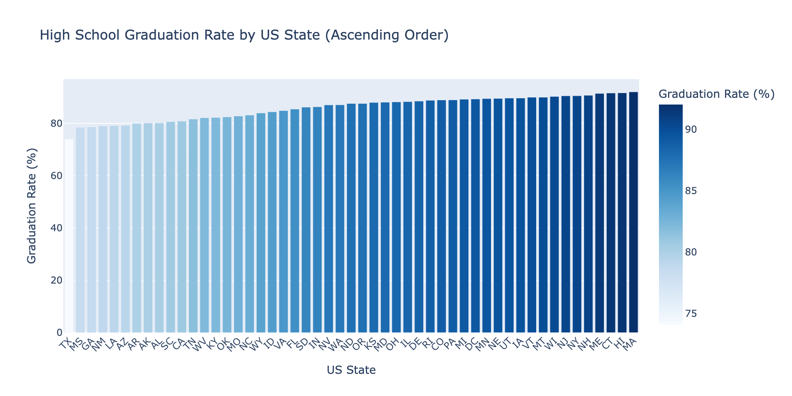
* **What it explains:** Shows the percentage of adults aged 25 and older who completed high school across US states in ascending order.
* **Key Insights:** Texas ranks lowest in high school completion with only **74.09%** of adults holding a diploma, while Massachusetts leads the nation at **92.03%**. States in the Deep South systematically cluster at the lower end of educational attainment.

---

#### Chart 3: Poverty Rate vs. High School Graduation Rate (Dual-Axis Line Plot)
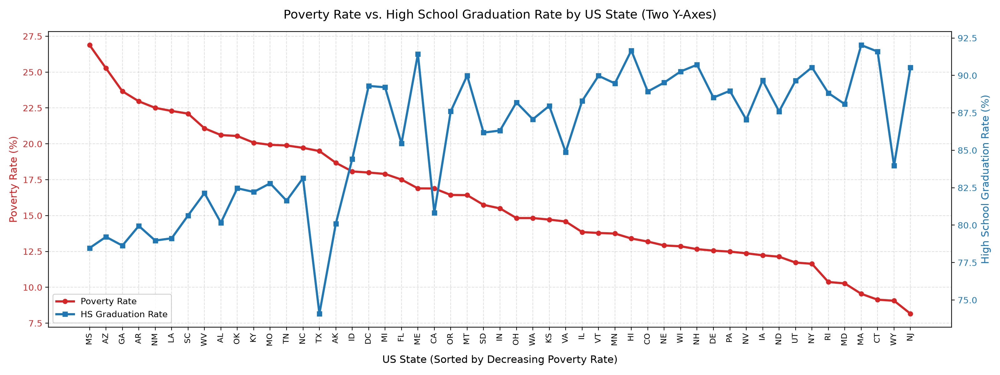
* **What it explains:** Overlays state poverty rates (red line, left axis) against high school graduation rates (blue line, right axis) sorted by decreasing poverty.
* **Key Insights:** The two lines exhibit mirror-image symmetry, showing that educational attainment consistently falls as poverty rises. This visualizes how economic hardship and low educational opportunities compound in vulnerable states.

---

#### Chart 4: Jointplot Scatter with Marginal Distributions
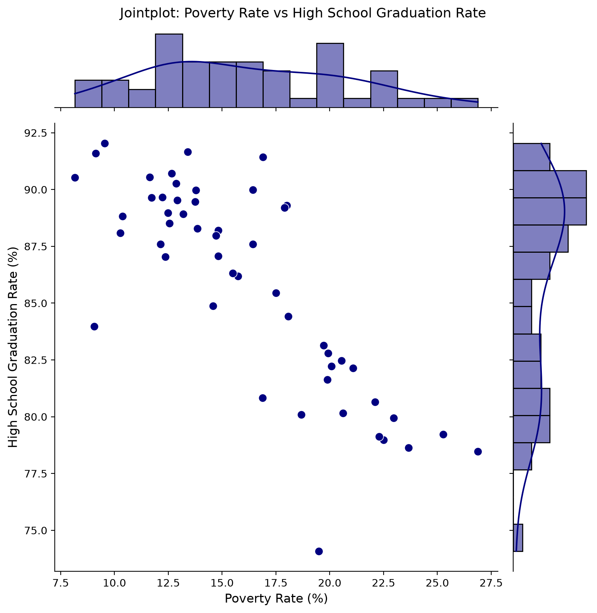
* **What it explains:** Examines the bivariate relationship between poverty rate and graduation rate with individual state markers and marginal univariate KDE/histogram distributions.
* **Key Insights:** Data points cluster tightly along a downward sloping path with no extreme outliers, confirming a uniform national pattern. The marginal distributions highlight that most states have poverty rates between 12% and 22% and graduation rates between 82% and 90%.

---

#### Chart 5: Jointplot 2D Kernel Density Estimate (KDE)
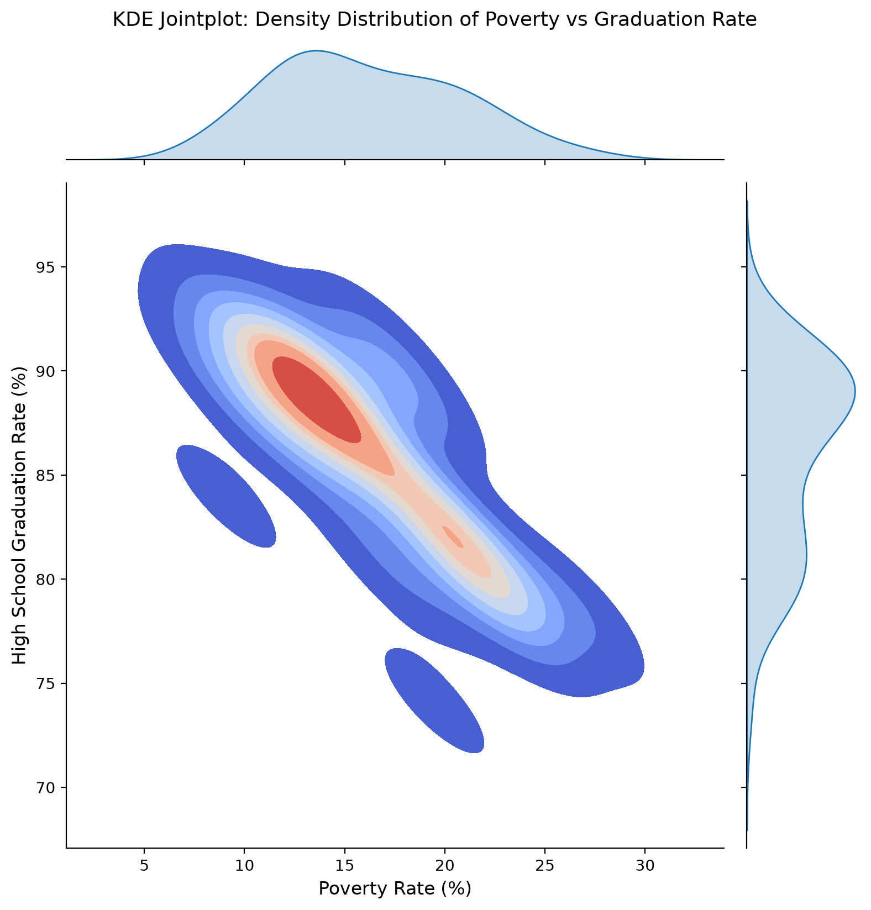
* **What it explains:** Displays the probability density contours of US states across the poverty rate and high school completion spectrum.
* **Key Insights:** The highest concentration of US states (darkest contour core) centers around an 85% graduation rate and 15% poverty rate. The elongated contour shape emphasizes the strong co-dependency of these two socioeconomic metrics.

---

#### Chart 6: Linear Regression: Poverty vs. Graduation Rate
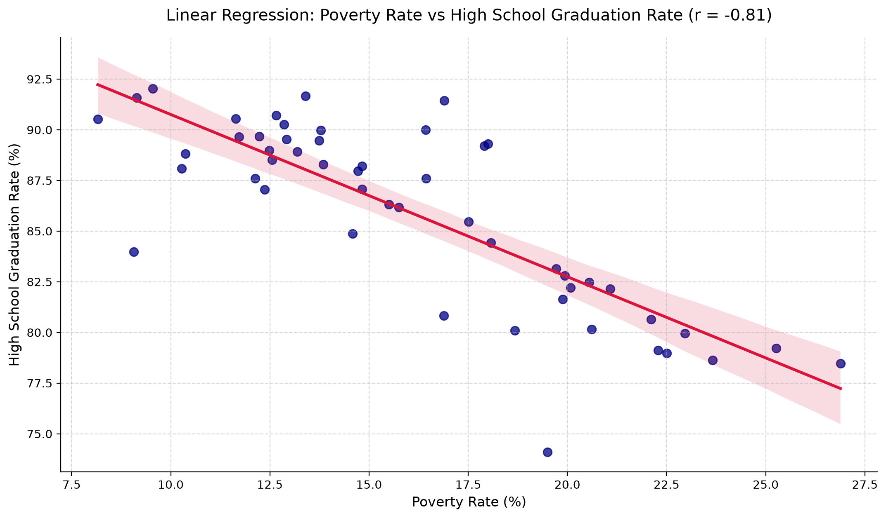
* **What it explains:** Fits an ordinary least squares (OLS) linear regression model between state poverty rates and high school graduation rates with a 95% confidence band.
* **Key Insights:** The relationship shows a very strong negative Pearson correlation coefficient of **$r = -0.81$**. For every percentage point increase in a state's poverty rate, the average high school graduation rate declines predictably.

---

### Section 2: Racial Makeup of States & Demographics of Shootings

#### Chart 7: Racial Makeup of Each US State (Stacked Bar Chart)
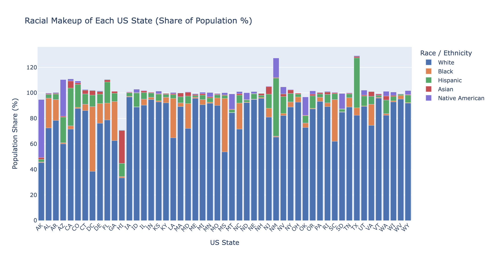
* **What it explains:** Breaks down the demographic proportions of White, Black, Hispanic, Asian, and Native American populations for each US state.
* **Key Insights:** Demonstrates massive demographic divergence across the country, from heavily Latino populations in California and Texas to substantial Black populations across the South and majority Native American representation in Alaska. This baseline provides essential context when evaluating the proportionality of police encounters.

---

#### Chart 8: Proportion of Police Killings by Race (Donut Chart)
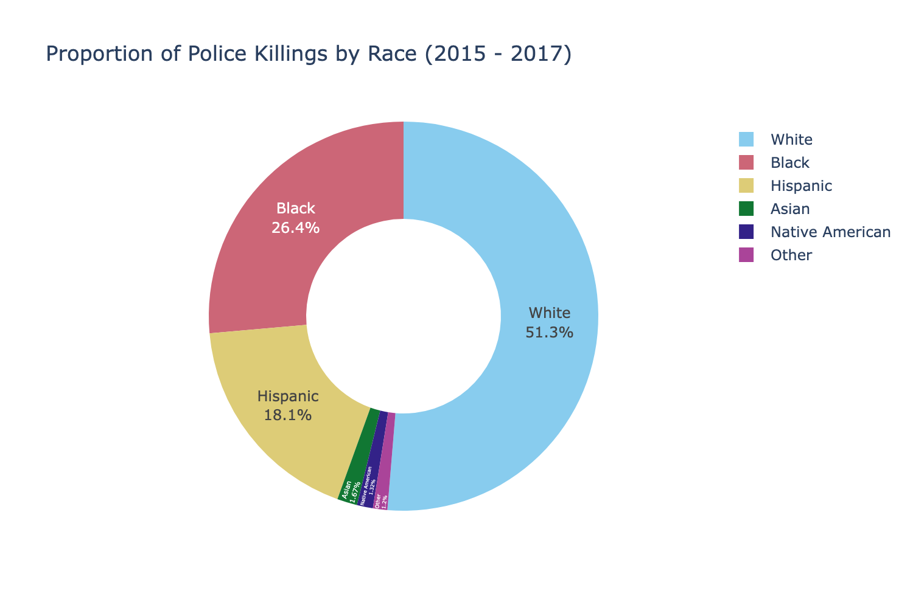
* **What it explains:** Shows the percentage breakdown of police shooting victims with recorded race.
* **Key Insights:** White victims make up **51.3%** of deaths, while Black victims account for **26.4%** and Hispanic victims represent **18.1%**. Because Black Americans comprise only ~13% of the US population, their 26.4% share of fatalities reflects a **2x national overrepresentation**.

---

#### Chart 9: Total Police Killings: Men vs. Women
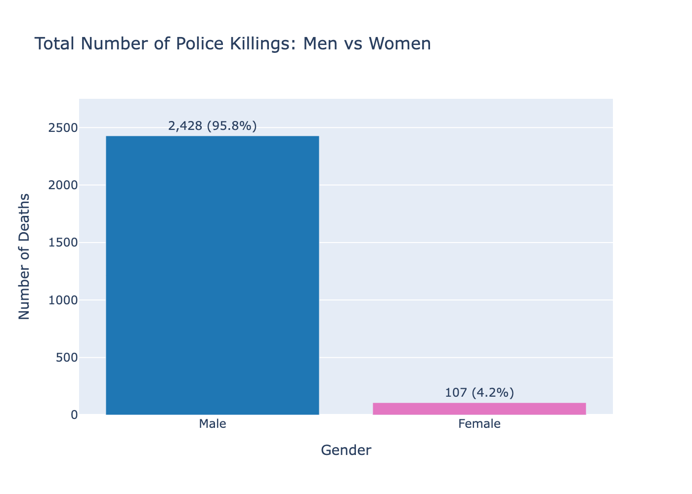
* **What it explains:** Compares the total volume and percentage of fatal police shootings between male and female victims.
* **Key Insights:** Men account for **95.8% (2,428 deaths)** while women account for **4.2% (107 deaths)**, representing a ratio of **22.7 men killed for every 1 woman**. Men are overwhelmingly more likely to be involved in confrontational armed police encounters.

---

### Section 3: Gender Disparities & Age Distribution

#### Chart 10: Age and Manner of Death by Gender (Box Plot)
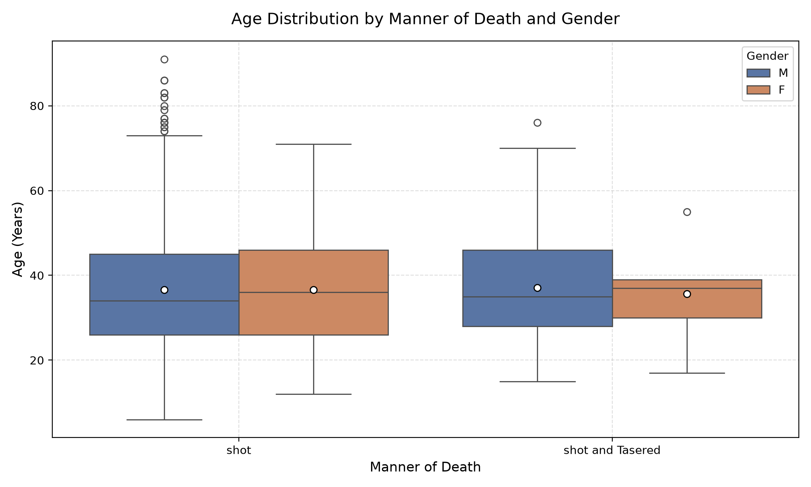
* **What it explains:** Compares victim age distributions categorized by manner of death (`shot` vs. `shot and Tasered`) and broken out by gender.
* **Key Insights:** Both men and women have remarkably similar median ages (**~35–36 years**) across both manners of death. However, male victims exhibit a vastly wider age range (6 to 91 years) with far more extreme outliers than female victims (12 to 71 years).

---

#### Chart 11: Top 10 Weapons Carried by Victims
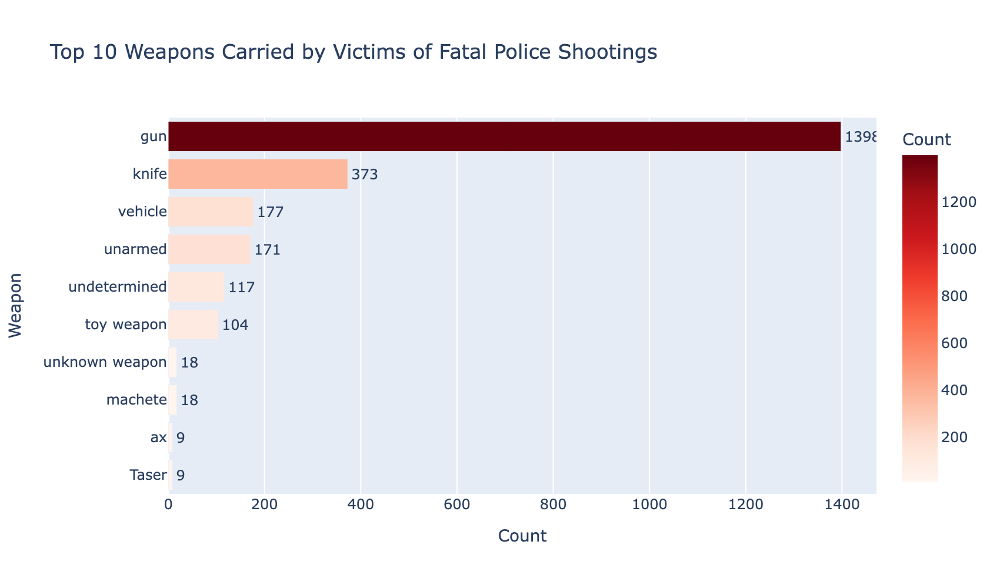
* **What it explains:** Ranks the 10 most common weapons or items carried by individuals when fatally shot by police officers.
* **Key Insights:** Firearms are by far the leading weapon (**1,398 victims**), followed by knives (373) and vehicles (177). Notably, unarmed individuals (171) and those carrying toy weapons (104) represent substantial numbers of fatal encounters.

---

#### Chart 12: Weapon Categories: Guns vs. Unarmed vs. Other Weapons
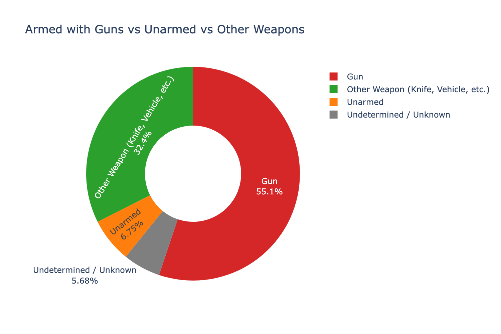
* **What it explains:** Groups weapon types into high-level categories: Gun, Unarmed, Other Weapons (knives, vehicles, bats), and Undetermined.
* **Key Insights:** Over **55.1%** of all deceased individuals were armed with a firearm, and overall **87.6%** were confirmed armed. Unarmed victims make up **6.75%** of the database, meaning that for every unarmed person killed, more than 8 people armed with guns were killed.

---

#### Chart 13: Age Distribution of People Killed (Histogram & KDE)
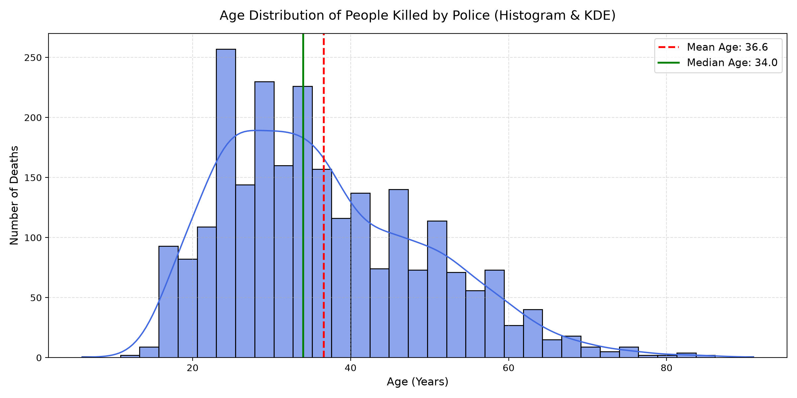
* **What it explains:** Displays the overall age distribution of police shooting victims with a kernel density estimate and mean/median indicators.
* **Key Insights:** The distribution is right-skewed with a mean age of **36.6 years** and a median of **35.0 years**. Young adults comprise a large portion of fatalities, with **18.31% of victims (450 people) being under 25 years old**.

---

#### Chart 14: Age Distribution by Race (KDE Density Comparison)
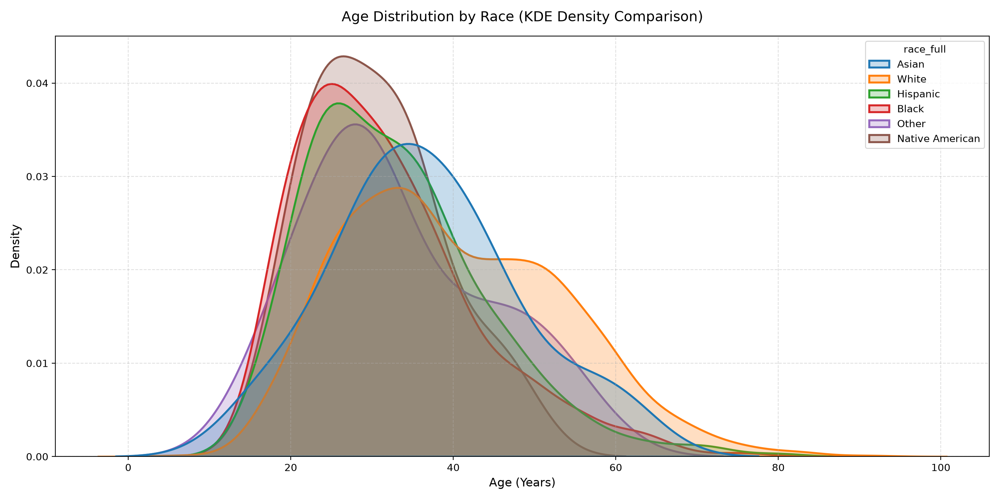
* **What it explains:** Overlays separate kernel density curves for each racial demographic to illustrate differences in victim ages.
* **Key Insights:** Black (median age **30.0**), Hispanic (median age **31.0**), and Native American (median age **29.0**) victims are fatally shot nearly a decade younger than White victims (median age **38.0**, mean **40.0**). The density curves for Black and Hispanic individuals peak sharply in the early twenties.

---

#### Chart 15: Total Number of Fatal Shootings by Race
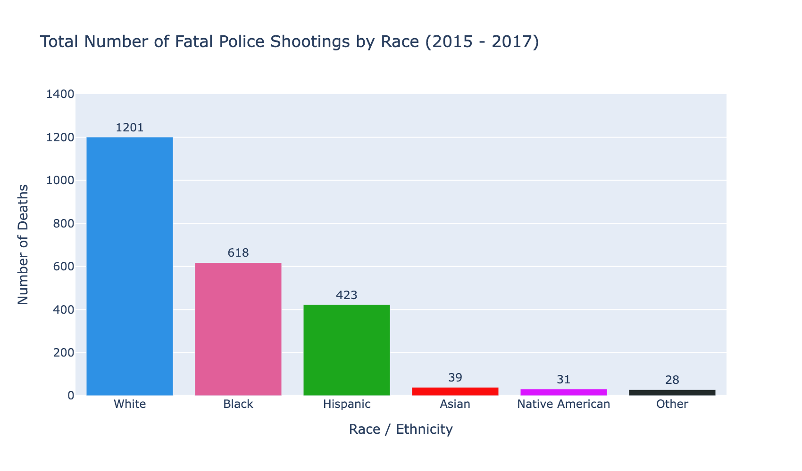
* **What it explains:** Bar chart displaying the absolute number of people killed by race across the United States.
* **Key Insights:** White victims total **1,201**, Black victims total **618**, and Hispanic victims total **423**. While White victims represent the largest absolute count, racial minority groups experience far higher per capita fatality rates.

---

### Section 4: Weapons Carried & Mental Health Crises

#### Chart 16: Proportion of Victims Showing Signs of Mental Illness
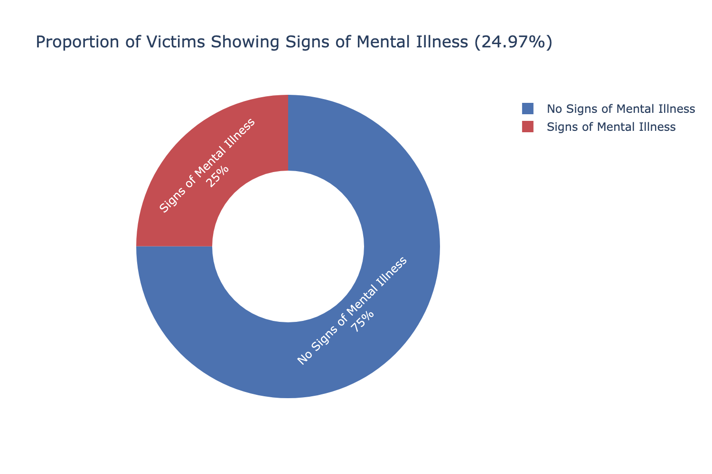
* **What it explains:** Illustrates the proportion of shooting victims who were exhibiting acute signs of mental illness or psychiatric distress.
* **Key Insights:** Nearly **1 in every 4 victims (24.97%, or 633 individuals)** had documented signs of mental illness or was experiencing an acute crisis. This highlights the grave risks of dispatching armed officers as primary responders to psychiatric emergencies.

---

#### Chart 17: Top 10 Cities with the Most Police Killings
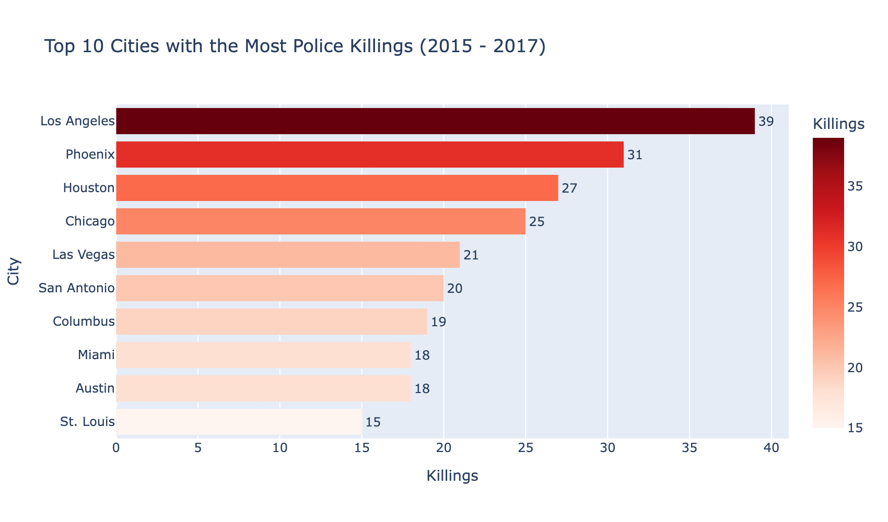
* **What it explains:** Identifies and ranks the top 10 municipal cities across the US with the highest raw counts of fatal police shootings.
* **Key Insights:** Los Angeles leads the nation with **39 fatalities**, followed closely by Phoenix (31), Houston (27), and Chicago (25). Large western and southwestern metropolitan centers dominate the top rankings.

---

### Section 5: Geographic Patterns & Urban Racial Disparities

#### Chart 18: Racial Disparity in Top 10 Cities: Population Share vs. Police Shootings
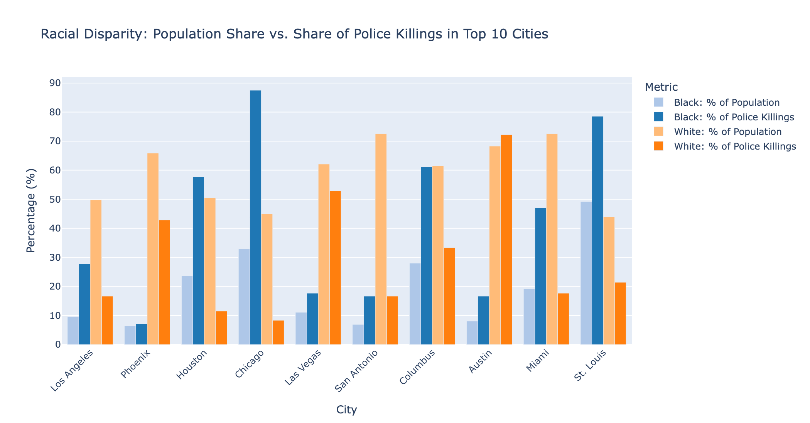
* **What it explains:** Compares the percentage of Black and White city residents from Census data against their respective share of fatal police shootings in the top 10 cities.
* **Key Insights:** In Chicago, Black residents make up **32.9%** of the population but account for **87.5% of fatal police shootings (2.7x overrepresented)**. Similar severe disparities appear in St. Louis (**78.6% of deaths vs. 49.2% population**) and Houston (**57.7% of deaths vs. 23.7% population**).

---

#### Chart 19: Total Number of Police Killings by US State (Choropleth Map)
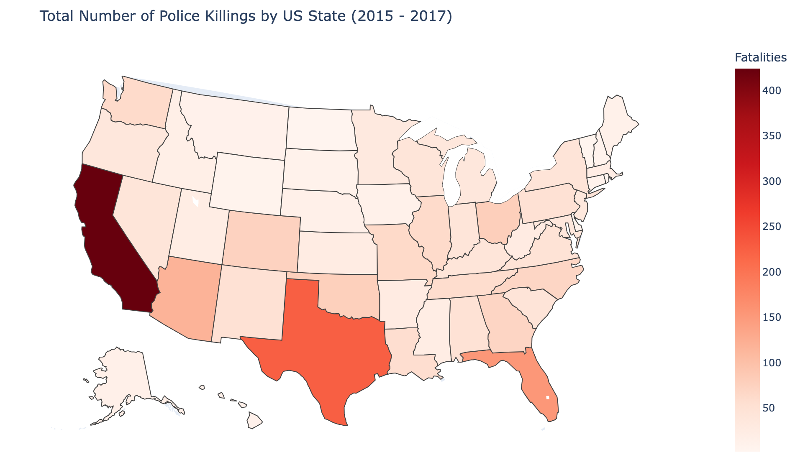
* **What it explains:** A geographic choropleth heat map visualizing total fatal police shootings across all 50 states.
* **Key Insights:** California (**424**), Texas (**225**), and Florida (**154**) register the highest absolute volumes, largely due to population size. However, states across the Sun Belt and Southwest exhibit consistently elevated fatality concentrations.

---

#### Chart 20: Police Killings vs. Average State Poverty Rate (Scatter Plot)
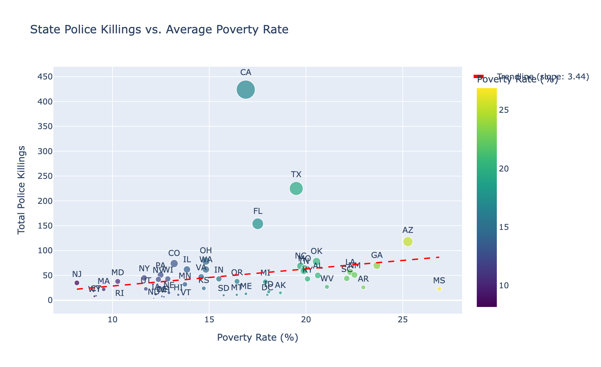
* **What it explains:** Plots total state police killings against average state poverty rates with an OLS trendline.
* **Key Insights:** While raw fatalities are strongly influenced by state population size, high-poverty states like Arizona (118 fatalities, 25.3% poverty) and Oklahoma (78 fatalities, 20.5% poverty) show elevated fatality rates. Poverty exacerbates the frequency and volatility of police-civilian interactions.

---

### Section 6: Temporal Trends Over Time

#### Chart 21: Fatal Police Shootings Over Time (Monthly Totals & 3-Month Moving Average)
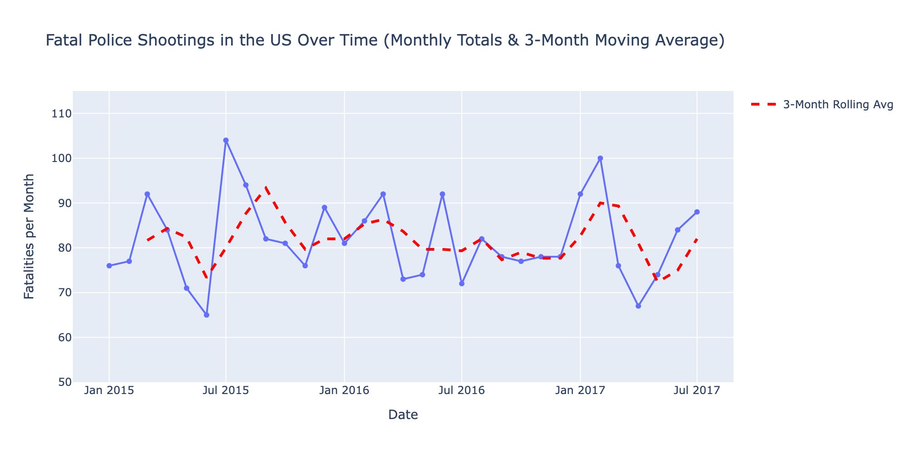
* **What it explains:** Tracks monthly fatal shooting totals from January 2015 to July 2017 with a 3-month rolling average line.
* **Key Insights:** Monthly deaths fluctuate within a tight band between 65 and 104, averaging **81.8 fatalities per month**. The statistical trend slope is virtually flat (**$-0.038$ deaths/month**), confirming that police shootings remained stubbornly constant at ~1,000 deaths per year despite intense national scrutiny.

---

#### Chart 22: Fatal Police Shootings by Day of the Week
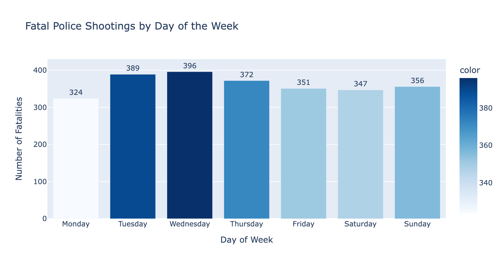
* **What it explains:** Examines the distribution of fatal police shootings across each day of the week.
* **Key Insights:** Shootings are distributed remarkably evenly throughout the week, ranging between 330 and 390 deaths per day. Incidents peak slightly during mid-week to weekends (Tuesday and Wednesday lead), showing that deadly encounters are an ongoing daily occurrence rather than weekend-isolated phenomena.

---

## Summary of Key Findings

1. **Persistent Baseline:** Police in the United States fatally shoot approximately **1,000 people annually** (~82 per month). The rate remained essentially flat across 2015–2017.
2. **Socioeconomic Vulnerability:** State poverty rates strongly correlate with lower educational attainment ($r = -0.81$), concentrating police enforcement in economically disadvantaged communities.
3. **Severe Racial Disproportion:** Black Americans are killed at **more than twice their demographic proportion** nationally, and in major cities like Chicago and Houston, Black victims account for **57% to 88% of all fatal shootings**.
4. **The Youth Disparity:** Black, Hispanic, and Native American victims are killed roughly **a decade younger** (median age ~29–31) than White victims (median age 38).
5. **Mental Health Crisis:** **25% of victims** suffered from a documented mental illness or acute crisis, underscoring the urgent need for unarmed psychiatric first responders.
6. **Weapons Reality:** **55%** of victims were armed with guns; **6.75%** (171 people) were completely unarmed.

---

## Repository Structure

```
.
├── Fatal_Force_(start).ipynb          # Fully executed Jupyter Notebook with 76 cells
├── ANALYSIS_REPORT.md                 # In-depth narrative investigative report
├── README.md                          # Detailed project documentation and image catalog
├── Deaths_by_Police_US.csv            # Washington Post shooting records
├── Median_Household_Income_2015.csv   # Census income dataset
├── Pct_Over_25_Completed_High_School.csv # Census education dataset
├── Pct_People_Below_Poverty_Level.csv # Census poverty dataset
├── Share_of_Race_By_City.csv          # Census racial demographics dataset
└── images/                            # 22 high-resolution generated analytical charts
    ├── 01_poverty_rate_by_state.png
    ├── 02_hs_graduation_rate_by_state.png
    ├── 03_poverty_vs_hs_dual_axis.png
    ├── ...
    └── 22_shootings_by_day_of_week.png
```

---

## How to Run Locally

1. **Clone this repository:**
   ```bash
   git clone https://github.com/Yuvansh-thx/fatal-force-police-shootings-analysis.git
   cd fatal-force-police-shootings-analysis
   ```

2. **Install required dependencies:**
   ```bash
   pip install numpy pandas matplotlib seaborn plotly kaleido
   ```

3. **Launch the Jupyter Notebook:**
   ```bash
   jupyter notebook "Fatal_Force_(start).ipynb"
   ```
   *Run all cells (`Cell -> Run All`) to regenerate and explore the interactive Plotly figures and statistical models.*

---

## Tech Stack & Libraries

* **Python 3.14+**
* **Pandas**: Data ingestion, manipulation, aggregation, and merging.
* **NumPy**: Linear regressions, trendline modeling, array math.
* **Plotly Express & Graph Objects**: Interactive choropleth maps, bar charts, and donut plots.
* **Seaborn**: Kernel density estimates, joint distribution plots, and regression models.
* **Matplotlib**: Dual-axis line charts and multi-panel styling.
* **Kaleido**: Headless image rendering engine for exporting static chart graphics.
